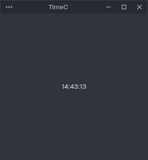

## Simple Clock in C using X11, GTK

Used X11 UI and Standard Headerfile `time.h`

Xlib Documentation: https://tronche.com/gui/x/xlib/

- [Opening the Display](https://tronche.com/gui/x/xlib/display/opening.html)
- [Window Functions](https://tronche.com/gui/x/xlib/window/)
- [XCreateWindow](https://tronche.com/gui/x/xlib/window/XCreateWindow.html)
- [XDestroyWindow](https://tronche.com/gui/x/xlib/window/XDestroyWindow.html)

[Shady Tutorial from the depths of the Internet](http://mech.math.msu.su/~vvb/2course/Borisenko/CppProjects/GWindow/xintro.html)

### GTK

- [Getting Started](https://www.gtk.org/docs/getting-started/hello-world/#getting-started)
- [Widget Gallery](https://docs.gtk.org/gtk4/visual_index.html)

- [Timeout Function](https://docs.gtk.org/glib/func.timeout_add.html)
- [Tutorial](https://youtu.be/PMZ9BFgane4)

