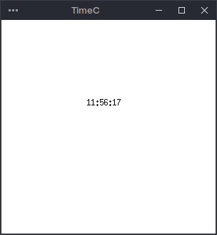
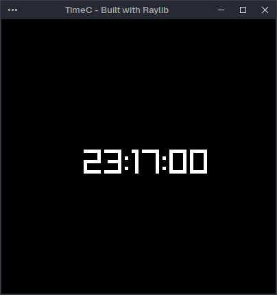

## Simple Clock in C using X11, GTK and Raylib

### X11 / Xorg

Xlib Documentation: https://tronche.com/gui/x/xlib/

- [Opening the Display](https://tronche.com/gui/x/xlib/display/opening.html)
- [Window Functions](https://tronche.com/gui/x/xlib/window/)
- [XCreateWindow](https://tronche.com/gui/x/xlib/window/XCreateWindow.html)
- [XDestroyWindow](https://tronche.com/gui/x/xlib/window/XDestroyWindow.html)

[Shady 1996 Tutorial from the depths of the Internet](http://mech.math.msu.su/~vvb/2course/Borisenko/CppProjects/GWindow/xintro.html)

### GTK

- [Getting Started](https://www.gtk.org/docs/getting-started/hello-world/#getting-started)
- [Widget Gallery](https://docs.gtk.org/gtk4/visual_index.html)
- [Timeout Function](https://docs.gtk.org/glib/func.timeout_add.html)
- [Tutorial](https://youtu.be/PMZ9BFgane4)

### Raylib

- [Installing Raylib on Ubuntu/based distros](https://medium.com/@filip.melka/getting-started-with-raylib-on-linux-mint-bf5f9242638d)
- [Basic Example](https://www.raylib.com/examples/core/loader.html?name=core_basic_window)
- [Resizable Window](https://www.reddit.com/r/raylib/comments/a19a67/resizable_window_questions/)

## Some Stats

### Memory Usage
X11 - **2.4MB**
GTK - **119MB**
Raylib - **91MB**

* X11 does not come in the same category as GTK or Raylib, since it is a Window Manager

### Binary Size
All of them are roughly 17KB. Terry would call it bloated, probably